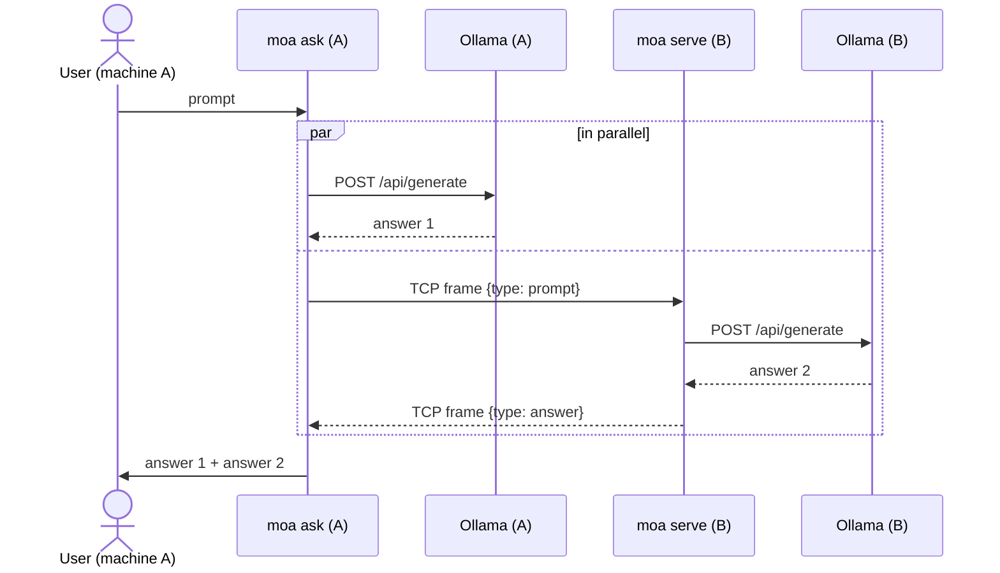
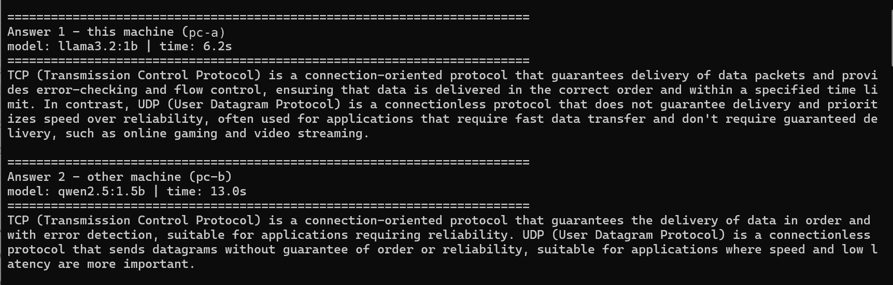
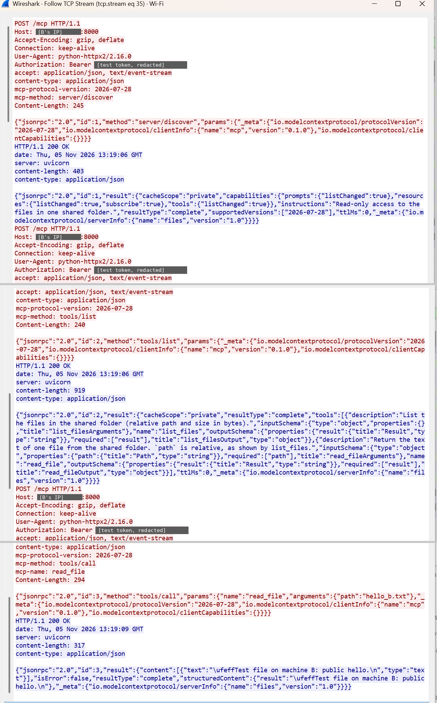

# Two-Machine Ollama Prompt Sharing

One prompt, two machines, two answers.

A user on **machine A** types a prompt. The program runs it on A's own Ollama and,
at the same time, sends it over the network to **machine B**, where the same program
runs it on B's Ollama and sends the answer back. A prints both answers.

There is no central server and no proxy in front of Ollama: just two identical peers.
The basic mode uses only the Python standard library. Agent mode (each machine's model can use
tools from MCP servers, see [Agent mode](#agent-mode-mcp-connectors)) needs the MCP SDK: `pip install -r requirements.txt`.

## How it works



| File | Role |
|---|---|
| `moa/protocol.py` | Wire format between the peers: length-prefixed JSON over TCP |
| `moa/ollama_client.py` | Calls the local Ollama REST API (`/api/tags`, `/api/generate`) |
| `moa/peer.py` | `PeerServer` (answers prompts from the other machine) and `ask_peer` (sends a prompt to it) |
| `moa/core.py` | `ask_both`: runs local and remote in parallel, collects both answers |
| `moa/cli.py` | Command line: `serve` and `ask` |
| `tests/` | Unit and end-to-end tests with a fake Ollama |

## Requirements

* Python 3.9+ on both machines (3.10+ for agent mode)
* [Ollama](https://ollama.com) installed and running on both machines, with at least one model pulled, e.g. `ollama pull llama3.2`
* The two machines can reach each other over the network (same LAN, or a VPN such as Tailscale)

## Running on two machines

Copy (or `git clone`) this folder to both machines.

**Machine B** (answers):

```bash
python -m moa serve --token <shared-secret>
# [serve] 'machine-B' listening on 0.0.0.0:5005, using Ollama at http://127.0.0.1:11434
```

Find B's IP address (`ipconfig` on Windows, `hostname -I` on Linux, `ipconfig getifaddr en0` on macOS)
and allow inbound TCP on port 5005 if a firewall is active:

```bash
# Windows (Administrator):
netsh advfirewall firewall add rule name="moa" dir=in action=allow protocol=TCP localport=5005
# Linux (ufw):
sudo ufw allow 5005/tcp
```

**Machine A** (asks):

```bash
# one prompt
python -m moa ask --peer 192.168.1.20 --token <shared-secret> "Explain TCP vs UDP in two sentences"

# interactive session
python -m moa ask --peer 192.168.1.20 --token <shared-secret>
```

Output of a real run on two machines (`--diverse`, a different model on each side):



Useful options:

| Option | Meaning |
|---|---|
| `--model NAME` | Model on this machine (default: first installed model) |
| `--peer-model NAME` | Ask the other machine to use a specific model (default: its own) |
| `--diverse` | Ask the other machine to answer with a different model than this one, if it has one |
| `--json` | Print both answers as JSON (for scripts) |
| `--serve` (with `ask`) | Also answer the other machine, so both users can ask each other |
| `--ollama URL` | Ollama address if not `http://127.0.0.1:11434` |
| `--timeout SEC` | Max wait for a model answer (default 300) |

The token can also be set with the `MOA_TOKEN` environment variable (PowerShell: `$env:MOA_TOKEN = "..."`). Exit code is `0` when both
answers arrived and `1` otherwise.

### Trying it on a single computer

Run a second Ollama instance on another port and point `serve` at it:

```bash
# terminal 1 - second Ollama instance (PowerShell: $env:OLLAMA_HOST="127.0.0.1:11435"; ollama serve)
OLLAMA_HOST=127.0.0.1:11435 ollama serve
# terminal 2
python -m moa serve --ollama http://127.0.0.1:11435 --port 5005
# terminal 3
python -m moa ask --peer 127.0.0.1:5005 "Hello"
```

## Protocol

TCP is a byte stream with no message boundaries, so every message is framed as a
4-byte big-endian length followed by that many bytes of UTF-8 JSON.

```
prompt  A -> B   {"v":1, "type":"prompt", "id":"<uuid>", "prompt":"...", "model":null, "avoid_model":null, "token":"..."}
answer  B -> A   {"v":1, "type":"answer", "id":"<uuid>", "ok":true,  "node":"B", "model":"qwen2.5", "answer":"...", "elapsed_ms":6800}
                 {"v":1, "type":"answer", "id":"<uuid>", "ok":false, "node":"B", "error":"..."}
```

One TCP connection carries one request and one reply. The `id` lets A verify that
the reply belongs to its request; `v` allows the protocol to evolve.

### Different models on each side (`--diverse`)

Two answers from the same model compare poorly, so with `--diverse` machine A first
resolves its own model (one quick local `/api/tags` call) and sends its name as
`avoid_model`. Machine B then chooses, in order:

1. the model A asked for explicitly (`--peer-model`),
2. B's own pinned model (`serve --model`),
3. the first installed model that differs from `avoid_model`,
4. if B has no other model, the same one; A prints a note saying so.

Model names are compared the way Ollama treats them: `llama3.2` equals `llama3.2:latest`.
`avoid_model` is optional, so peers running the earlier version simply ignore it and
the protocol version did not need to change.

## Design decisions

* **Ollama is never exposed to the network.** It stays on `127.0.0.1` on both machines.
  Only the small peer service is reachable, and it only accepts well-formed prompt messages.
  Ollama's own API has no authentication, so exposing it (`OLLAMA_HOST=0.0.0.0`) would
  give anyone on the network full control of it, including pulling and deleting models.
* **Parallel, not sequential.** Both requests run at the same time, so the wait is
  `max(local, remote)` instead of `local + remote`.
* **Partial failure is visible, not fatal.** If B is down or its model is missing, A still
  shows its own answer and a clear error for B (and vice versa).
* **Shared token**, compared in constant time (`hmac.compare_digest`).
* **Bounded resources**: 16 MiB maximum message size, connect timeout, read timeouts.
* **No dependencies in the basic mode**: `socket`, `socketserver`, `urllib`, `json`, `concurrent.futures`.
  Agent mode adds the official MCP SDK (`mcp`), imported only when a config is given.

## Agent mode (MCP connectors)

With `--config moa.json`, each machine answers as an **agent**: its model can use tools from MCP
servers ("connectors"). There are three ways for the machines to work together, usable separately
or at the same time:

| Channel | Transport | Who decides to run a tool | What crosses the network |
|---|---|---|---|
| ① Local MCP | stdio (child process) | this machine's model, on this machine's tools | nothing |
| ② Remote MCP | Streamable HTTP + bearer token | **A's model, on tools that B exposes** (no model on B) | MCP messages (`tools/list`, `tools/call`) |
| ③ Agent to agent | the TCP protocol above | B's model, on B's tools, within B's allowlist | a prompt and an answer |

```
                 machine A                                          machine B
 model A <-> agent A --① stdio--> files server (shared/)
                    |--② MCP over HTTP + token ------------------> files server (public/), port 8000
                    `--③ TCP: prompt / answer -------------------> agent B --① stdio--> files server (shared/)
```

The model never talks to an MCP server. `moa/agent.py` does: it connects to every configured
server, lists its tools (`tools/list`), sends their descriptions to the model with Ollama's
`/api/chat`, runs every tool the model asks for (`tools/call`), sends the result back, and repeats
until the model answers without asking for a tool. Each answer lists the tool calls behind it, for
example `tools: my_files__list_files() ok; pc_b_files__read_file(path='calendar.txt') ok`.

**Tool names.** Every tool is shown to the model as `<server>__<tool>`, and its description says which
server (local or remote, with its URL) it belongs to. Without this, this machine's files server and
the other machine's files server would offer the same names and the model could not tell them apart.

### Setup (both machines)

```bash
pip install -r requirements.txt
ollama pull qwen2.5:7b       # a model with tool support (`ollama show <model>` lists "tools")
```

In the real run below, machine A used `qwen2.5:7b` and machine B `llama3.2:3b`.

### ① and ③: local tools, and agent to agent

```bash
cp moa.example.json moa.json     # Windows: copy moa.example.json moa.json
mkdir shared                     # put a few text files in it
# machine B
python -m moa serve --config moa.json --token <shared-secret>
# machine A
python -m moa ask --peer <B's IP> --config moa.json --token <shared-secret> "Which files do you have?"
```

Both machines answer, each from its own folder. `remoteAllowedTools` (on B) lists the tools a
prompt **from the peer** may make B's agent use; tools not listed are not even offered to the model.
The default is none (a plain model).

### ②: A's model uses B's tools directly

On B, expose a separate folder over HTTP. The token is read from an environment variable and must be
at least 16 characters:

```powershell
$env:MOA_MCP_TOKEN = "<long random token>"
mkdir public                     # test files only, nothing sensitive
python -m moa.servers.files --root public --http 192.168.10.7:8000
```

On A, copy `moa.remote-example.json` to `moa.remote.json` (set B's address in `url`), set the same
token in `MOA_MCP_TOKEN`, and ask without `--peer`; only A's model answers, using its own and B's
tools:

```bash
python -m moa ask --config moa.remote.json "Use the pc_b_files__read_file tool to read hello_b.txt."
```

`moa.json` never contains the token itself, only the name of the variable that holds it
(`tokenEnv`). Relative paths are relative to the folder of `moa.json`, and `"python"` means the
interpreter that runs moa. The layout of `mcpServers` is the same as Claude Desktop's, so other
MCP servers can be added.

### The included connector: `moa.servers.files`

A small MCP server written for this project (`moa/servers/files.py`). It exposes one folder,
read-only, with two tools: `list_files` and `read_file(path)`. Paths that resolve outside the folder
(`../x`, absolute paths, symlinks pointing out) are refused, and files over 64 KiB are not read.
It runs over stdio by default, or over Streamable HTTP with `--http HOST:PORT`.

### Security

Every limit on B's data is enforced on B; filtering on the client side is not counted as protection.

| Risk | Protection |
|---|---|
| Someone without permission calls B's HTTP server | Every request needs `Authorization: Bearer <token>`, checked through the SDK's `TokenVerifier` interface with a constant-time comparison; otherwise HTTP 401 |
| B's HTTP server started unprotected by mistake | It refuses to start without a token of 16+ characters |
| A web page in a browser on B's network calls the server (DNS rebinding) | Only the `Host` values given by `--http` / `--allow-host` are accepted (421 otherwise; `--allow-host` is required on `0.0.0.0`); no browser `Origin` is accepted (403) |
| A's model reads B's private files | The HTTP server exposes only its own folder (use a separate one, e.g. `public/`), read-only, and refuses paths that leave it |
| A prompt from the peer makes B's agent use tools | `remoteAllowedTools` on B (default: none) |
| A model that keeps calling tools | `maxToolCalls` |
| A remote server that is down or refuses the token | A warning in the answer; the agent continues with its other tools |

**Not encrypted.** Like the TCP protocol, HTTP sends the token and the files in clear text (which a
Wireshark capture will show). Use it only on a network you control with test data, never forward the
port to the internet, and use a VPN such as Tailscale (WireGuard, encrypted) between different
networks. HTTPS is a possible next step.

`AuthSettings` in the SDK comes from OAuth, where tokens are issued by a separate authorization
server. Here the token is a shared secret set by hand, so there is no such server and the URLs the
SDK requires point to the files server itself (they only appear in the metadata it publishes).

### What was tested

Automated tests cover the agent loop, the files server over stdio and over HTTP, and all three
channels, using a scripted fake model and the real MCP servers: `tests/test_agent.py`,
`tests/test_files_http.py` (authentication and host checks against a running HTTP server) and
`tests/test_agent_remote.py` (one answer using a local and a remote tool, wrong or missing token,
unreachable server, allowlists). The fake model shows that the code works; it says nothing about
how well a real model uses tools. For that, see
[Findings from a real run of agent mode](#findings-from-a-real-run-of-agent-mode).

Design note: local MCP servers are started for each prompt and remote ones are connected for each
prompt, then closed. This is simple and keeps requests independent, at the cost of starting a process
per prompt (in the test environment a full round with the fake model took about 1.5 s, most of it
starting the local server).

## Tests

```bash
python -m unittest -v
```

The tests replace Ollama with a small fake HTTP server (`tests/fake_ollama.py`), so they
run anywhere without a model. They cover framing (split and merged TCP reads, truncated
and oversized messages), the full two-peer flow, parallel execution, peer down,
local Ollama down, unknown model, token enforcement and the CLI's JSON output.
The agent-mode tests (described in [What was tested](#what-was-tested)) also start the real
MCP servers, so they need `pip install -r requirements.txt`.

## Findings from a real two-machine run

Setup: two Windows PCs on the same home Wi-Fi (`192.168.10.6` asks, `192.168.10.7` serves),
each with its own Ollama. `--diverse` made them answer with different models
(`llama3.2:1b` on the asker, `qwen2.5:1.5b` on the server). Traffic was captured with
Wireshark on the server (`tcp.port == 5005`).

**1. The two sides really run in parallel.**

| Prompt | Asker (llama3.2:1b) | Server (qwen2.5:1.5b) | Wall time of the command |
|---|---|---|---|
| "Explain TCP vs UDP in two sentences" | 6.2 s | 13.0 s | about 13 s |
| "Write about 300 words on how TCP works" | 18.5 s | 68.2 s | about 68 s |

The command takes as long as the slower side, not the sum. The numbers are not a model
benchmark: each machine ran the prompt once (so model loading is included), the hardware
differs, and qwen wrote about twice as many words (515 vs 278) in the second run.

**2. The network is not the bottleneck.** The TCP handshake shows a round trip of roughly
14-19 ms. In the capture, the gap between the request and the first byte of the answer is
68.1 s for the long prompt, which matches the 68.2 s the program reported. All of that is inference.

**3. The wire format matches the protocol.** A short exchange is 10 packets: three-way
handshake, the request (194 bytes of payload), an ACK, the answer (550 bytes), and the
connection teardown, started by the server right after it sends the answer. The payload
sizes equal the 4-byte length prefix plus the JSON computed from the code (190 + 4 = 194 for
the request).


In Wireshark's "Follow TCP Stream" the prefix shows up as non-printable
characters right before the `{` of the JSON. For the 3,664-byte answer the last prefix byte
is displayed as `L`, which is `0x4C`: the prefix `00 00 0E 4C` is 3,660, the length of the JSON
that follows.

**4. Long answers arrive in several TCP segments.** The 3,664-byte answer to the long prompt
was sent as three segments of 1,460, 1,460 and 744 bytes; 1,460 is the MSS announced in the
`SYN` packet. A receiver therefore cannot assume that one `recv()` returns a whole message,
which is why `recv_message` reads the 4-byte length first and then loops in `_recv_exact`
until all bytes have arrived.


**5. Everything is readable on the wire.** The request is plain JSON, so the prompt, the
answer and the shared token are visible to anyone who can capture the traffic (Wireshark:
right-click a packet, Follow, TCP Stream). The token only keeps unwanted peers from using the
service; it does not protect the content. See the limitations below.


The answer also carries `elapsed_ms: 68116`, the server's own measurement of the Ollama call,
which agrees with the 68.1 s gap seen in the capture.

**6. Both small models made factual errors about TCP, different ones.** For the long prompt,
the llama answer says `SYN` stands for "Send Unencrypted" and that TCP uses 1,512-byte
segments (the capture shows 1,460). The qwen answer says TCP authenticates with a username and
password and mentions NAKs, which TCP does not have. These errors were found by checking each
answer by hand against the TCP specification and the capture of the same run; the system itself
does not detect them. Comparing the two answers only shows where they differ, not which one is
right. This is one prompt and two very small models, so it is an observation, not a measurement.

**7. Running on a real second machine found a bug the tests missed.** On Hebrew Windows,
output written to a pipe uses the cp1255 code page, so `ask --json` produced JSON that was not
valid UTF-8. The tests had passed on Linux. The CLI now forces UTF-8 when output is not a
console, and a regression test simulates the legacy encoding.

## Findings from a real run of agent mode

Setup: the same two Windows PCs. Machine A (`192.168.10.6`) ran `qwen2.5:7b`, machine B
(`192.168.10.7`) ran `llama3.2:3b`; `ollama show` lists `tools` for both. Each shared folder held
one or two short test files. Every result below is from one to three runs, so these are
observations, not reliability measurements. The models also differ in size and run on different
hardware, so a difference between A and B cannot be attributed to the model alone.

**Channel ①, local MCP.** On each machine, asked which files are in the shared folder and what the
file says, the model called `list_files` and then `read_file`, and quoted the file correctly
(one run each). Asked on A to read `..\secret.txt`, the model called `read_file` with that path and
the files server refused it as outside the shared folder. No such file existed there, so this run
shows the path check, not the protection of a real file (that case is covered by the automated tests).

**Channel ③, agent to agent: B's small model invented a file's content.**

| Prompt | Tool calls on B | B's answer |
|---|---|---|
| "List the files you can see and read the one you find. Then tell me what it says." (2 runs) | `list_files` only | Quoted a text that is not in the file, a different one each run |
| "Use the read_file tool to read b_notes.txt and tell me exactly what it says." (1 run) | `read_file` | The file's real content |

In the first two runs `read_file` was offered to B's model and allowed for remote prompts; the
model did not call it. For the first run, B's server log shows the same single call as the tool
record that came back over the protocol. The invented text was found by comparing the answer with the file by hand; the
system does not detect it. What the system does provide is the record of tool calls, which showed
that the file was never read. A's model answered correctly in all three runs (in the last one it
reported that `b_notes.txt` does not exist on A, which is true).

**Channel ②, remote MCP over HTTP.**

| Case | Result |
|---|---|
| Valid token, read `hello_b.txt` (3 runs) | `pc_b_files__read_file ... ok`, content quoted correctly |
| Wrong token (2 runs) | HTTP 401 (in the capture of the first run, on both of its requests); the answer carries `warning: MCP server 'pc_b_files' unavailable: ... refused the token (HTTP 401)` |
| Valid token, read `..\shared\b_notes.txt` (1 run) | Refused by B's server as outside its folder; the file's content was not returned |

With the wrong token, A's model then called its **local** `read_file` for `hello_b.txt`, which
failed, and answered that the file could not be found. That is misleading: the file exists on B.
The model had been told in a system message that `pc_b_files` was unavailable and why; after the
first run the message was made more explicit ("do not conclude that a file does not exist"), and
the second run gave the same kind of answer. The warning line is printed by the code, not written
by the model, so it is the reliable part of the output.

**What the capture shows (Wireshark, `tcp.port == 8000`, Follow TCP Stream).** One question with a
valid token was three `POST /mcp` requests on one connection, with headers `mcp-method:
server/discover`, `tools/list` and `tools/call` (`mcp-name: read_file`). Every request carries
`Authorization: Bearer <token>` in clear text, and the answer to `tools/call` contains the file's
text in clear text, together with `"isError": false`. The capture also showed that the file text
started with ``, a byte order mark written by Windows PowerShell 5 (`Set-Content -Encoding
utf8`); `read_file` now strips it.



**Conclusion.** The connections, the token check, the path check and the allowlists behaved as
designed in every run. The weak point was the models: with a general prompt, the small model on B
answered about a file it had not read, and A's model drew a wrong conclusion from a missing server.
In both cases the evidence was in the tool record and the warning line, not in the model's text.

## Limitations and possible next steps

* The token is sent in clear text. On an untrusted network, run over a VPN (Tailscale/WireGuard)
  or add TLS (an `ssl.SSLContext` wrapping the socket on both sides; HTTPS for the MCP server).
* Answers are returned when complete; streaming tokens as they are generated would need
  streaming frames in the protocol.
* Extends naturally to N peers (`--peer` repeated) and to a final step where a model
  merges or compares the answers (a Mixture-of-Agents aggregator).

## Note on how this was built

The code was written with an AI assistant (Claude). I ran and measured the system on two physical Windows computers, captured the traffic with Wireshark, and checked the results described above. I reviewed the code and can explain it.
