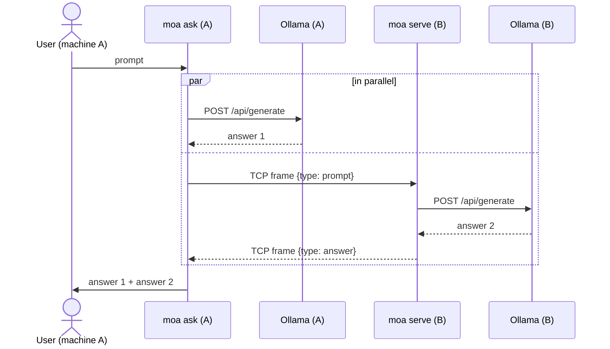

# Two-Machine Ollama Prompt Sharing

One prompt, two machines, two answers.

A user on **machine A** types a prompt. The program runs it on A's own Ollama and,
at the same time, sends it over the network to **machine B**, where the same program
runs it on B's Ollama and sends the answer back. A prints both answers.

There is no central server and no proxy in front of Ollama: just two identical peers.
Pure Python standard library, no dependencies to install.

## How it works



| File | Role |
|---|---|
| `moa/protocol.py` | Wire format between the peers: length-prefixed JSON over TCP |
| `moa/ollama_client.py` | Calls the local Ollama REST API (`/api/tags`, `/api/generate`) |
| `moa/peer.py` | `PeerServer` (answers prompts from the other machine) and `ask_peer` (sends a prompt to it) |
| `moa/core.py` | `ask_both`: runs local and remote in parallel, collects both answers |
| `moa/cli.py` | Command line: `serve` and `ask` |
| `tests/` | Unit and end-to-end tests with a fake Ollama |

## Requirements

* Python 3.9+ on both machines
* [Ollama](https://ollama.com) installed and running on both machines, with at least one model pulled, e.g. `ollama pull llama3.2`
* The two machines can reach each other over the network (same LAN, or a VPN such as Tailscale)

## Running on two machines

Copy (or `git clone`) this folder to both machines.

**Machine B** (answers):

```bash
python -m moa serve --token <shared-secret>
# [serve] 'machine-B' listening on 0.0.0.0:5005, using Ollama at http://127.0.0.1:11434
```

Find B's IP address (`ipconfig` on Windows, `hostname -I` on Linux, `ipconfig getifaddr en0` on macOS)
and allow inbound TCP on port 5005 if a firewall is active:

```bash
# Windows (Administrator):
netsh advfirewall firewall add rule name="moa" dir=in action=allow protocol=TCP localport=5005
# Linux (ufw):
sudo ufw allow 5005/tcp
```

**Machine A** (asks):

```bash
# one prompt
python -m moa ask --peer 192.168.1.20 --token <shared-secret> "Explain TCP vs UDP in two sentences"

# interactive session
python -m moa ask --peer 192.168.1.20 --token <shared-secret>
```

Output:

```
========================================================================
Answer 1 - this machine (machine-A)
model: llama3.2 | time: 4.2s
========================================================================
...

========================================================================
Answer 2 - other machine (machine-B)
model: qwen2.5 | time: 6.8s
========================================================================
...
```

Useful options:

| Option | Meaning |
|---|---|
| `--model NAME` | Model on this machine (default: first installed model) |
| `--peer-model NAME` | Ask the other machine to use a specific model (default: its own) |
| `--json` | Print both answers as JSON (for scripts) |
| `--serve` (with `ask`) | Also answer the other machine, so both users can ask each other |
| `--ollama URL` | Ollama address if not `http://127.0.0.1:11434` |
| `--timeout SEC` | Max wait for a model answer (default 300) |

The token can also be set with the `MOA_TOKEN` environment variable. Exit code is `0` when both
answers arrived and `1` otherwise.

### Trying it on a single computer

Run a second Ollama instance on another port and point `serve` at it:

```bash
# terminal 1 - second Ollama instance (PowerShell: $env:OLLAMA_HOST="127.0.0.1:11435"; ollama serve)
OLLAMA_HOST=127.0.0.1:11435 ollama serve
# terminal 2
python -m moa serve --ollama http://127.0.0.1:11435 --port 5005
# terminal 3
python -m moa ask --peer 127.0.0.1:5005 "Hello"
```

## Protocol

TCP is a byte stream with no message boundaries, so every message is framed as a
4-byte big-endian length followed by that many bytes of UTF-8 JSON.

```
prompt  A -> B   {"v":1, "type":"prompt", "id":"<uuid>", "prompt":"...", "model":null, "token":"..."}
answer  B -> A   {"v":1, "type":"answer", "id":"<uuid>", "ok":true,  "node":"B", "model":"qwen2.5", "answer":"...", "elapsed_ms":6800}
                 {"v":1, "type":"answer", "id":"<uuid>", "ok":false, "node":"B", "error":"..."}
```

One TCP connection carries one request and one reply. The `id` lets A verify that
the reply belongs to its request; `v` allows the protocol to evolve.

## Design decisions

* **Ollama is never exposed to the network.** It stays on `127.0.0.1` on both machines.
  Only the small peer service is reachable, and it only accepts well-formed prompt messages.
  Ollama's own API has no authentication, so exposing it (`OLLAMA_HOST=0.0.0.0`) would
  give anyone on the network full control of it, including pulling and deleting models.
* **Parallel, not sequential.** Both requests run at the same time, so the wait is
  `max(local, remote)` instead of `local + remote`.
* **Partial failure is visible, not fatal.** If B is down or its model is missing, A still
  shows its own answer and a clear error for B (and vice versa).
* **Shared token**, compared in constant time (`hmac.compare_digest`).
* **Bounded resources**: 16 MiB maximum message size, connect timeout, read timeouts.
* **No dependencies**: `socket`, `socketserver`, `urllib`, `json`, `concurrent.futures`.

## Tests

```bash
python -m unittest -v
```

The tests replace Ollama with a small fake HTTP server (`tests/fake_ollama.py`), so they
run anywhere without a model. They cover framing (split and merged TCP reads, truncated
and oversized messages), the full two-peer flow, parallel execution, peer down,
local Ollama down, unknown model, token enforcement and the CLI's JSON output.

## Limitations and possible next steps

* The token is sent in clear text. On an untrusted network, run over a VPN (Tailscale/WireGuard)
  or add TLS (`ssl.wrap_socket` on both sides).
* Answers are returned when complete; streaming tokens as they are generated would need
  streaming frames in the protocol.
* Extends naturally to N peers (`--peer` repeated) and to a final step where a model
  merges or compares the answers (a Mixture-of-Agents aggregator).

## Note on how this was built

Developed with the help of an AI coding assistant (Claude). I reviewed and tested the code
and can explain every part of it.
