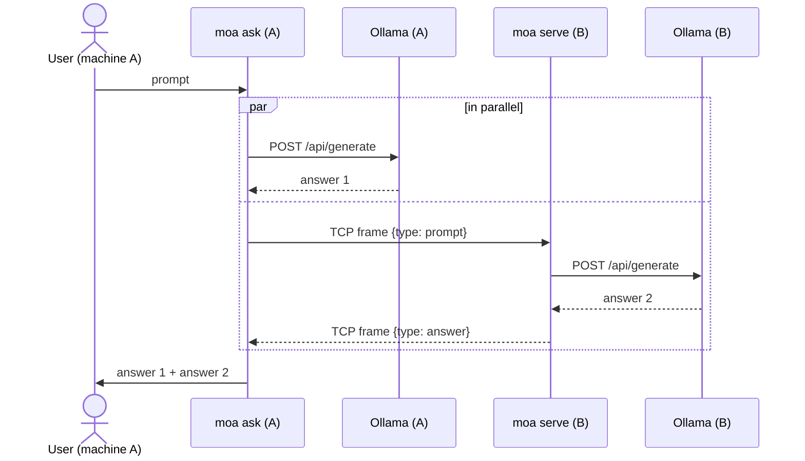
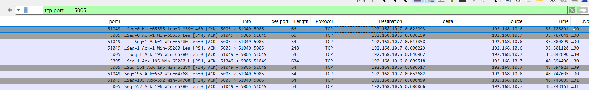
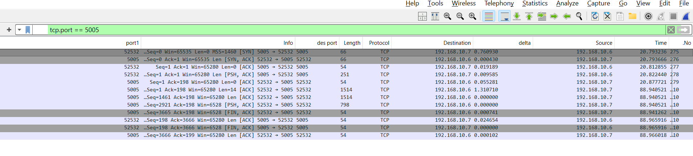
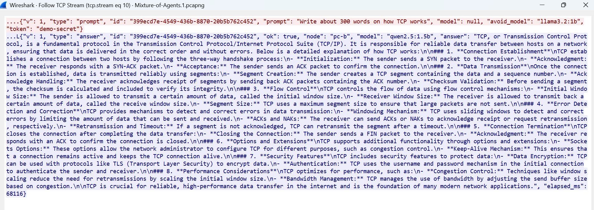

# Two-Machine Ollama Prompt Sharing

One prompt, two machines, two answers.

A user on **machine A** types a prompt. The program runs it on A's own Ollama and,
at the same time, sends it over the network to **machine B**, where the same program
runs it on B's Ollama and sends the answer back. A prints both answers.

There is no central server and no proxy in front of Ollama: just two identical peers.
Pure Python standard library, no dependencies to install.

## How it works



| File | Role |
|---|---|
| `moa/protocol.py` | Wire format between the peers: length-prefixed JSON over TCP |
| `moa/ollama_client.py` | Calls the local Ollama REST API (`/api/tags`, `/api/generate`) |
| `moa/peer.py` | `PeerServer` (answers prompts from the other machine) and `ask_peer` (sends a prompt to it) |
| `moa/core.py` | `ask_both`: runs local and remote in parallel, collects both answers |
| `moa/cli.py` | Command line: `serve` and `ask` |
| `tests/` | Unit and end-to-end tests with a fake Ollama |

## Requirements

* Python 3.9+ on both machines
* [Ollama](https://ollama.com) installed and running on both machines, with at least one model pulled, e.g. `ollama pull llama3.2`
* The two machines can reach each other over the network (same LAN, or a VPN such as Tailscale)

## Running on two machines

Copy (or `git clone`) this folder to both machines.

**Machine B** (answers):

```bash
python -m moa serve --token <shared-secret>
# [serve] 'machine-B' listening on 0.0.0.0:5005, using Ollama at http://127.0.0.1:11434
```

Find B's IP address (`ipconfig` on Windows, `hostname -I` on Linux, `ipconfig getifaddr en0` on macOS)
and allow inbound TCP on port 5005 if a firewall is active:

```bash
# Windows (Administrator):
netsh advfirewall firewall add rule name="moa" dir=in action=allow protocol=TCP localport=5005
# Linux (ufw):
sudo ufw allow 5005/tcp
```

**Machine A** (asks):

```bash
# one prompt
python -m moa ask --peer 192.168.1.20 --token <shared-secret> "Explain TCP vs UDP in two sentences"

# interactive session
python -m moa ask --peer 192.168.1.20 --token <shared-secret>
```

Output:

```
========================================================================
Answer 1 - this machine (machine-A)
model: llama3.2 | time: 4.2s
========================================================================
...

========================================================================
Answer 2 - other machine (machine-B)
model: qwen2.5 | time: 6.8s
========================================================================
...
```

Useful options:

| Option | Meaning |
|---|---|
| `--model NAME` | Model on this machine (default: first installed model) |
| `--peer-model NAME` | Ask the other machine to use a specific model (default: its own) |
| `--diverse` | Ask the other machine to answer with a different model than this one, if it has one |
| `--json` | Print both answers as JSON (for scripts) |
| `--serve` (with `ask`) | Also answer the other machine, so both users can ask each other |
| `--ollama URL` | Ollama address if not `http://127.0.0.1:11434` |
| `--timeout SEC` | Max wait for a model answer (default 300) |

The token can also be set with the `MOA_TOKEN` environment variable (PowerShell: `$env:MOA_TOKEN = "..."`). Exit code is `0` when both
answers arrived and `1` otherwise.

### Trying it on a single computer

Run a second Ollama instance on another port and point `serve` at it:

```bash
# terminal 1 - second Ollama instance (PowerShell: $env:OLLAMA_HOST="127.0.0.1:11435"; ollama serve)
OLLAMA_HOST=127.0.0.1:11435 ollama serve
# terminal 2
python -m moa serve --ollama http://127.0.0.1:11435 --port 5005
# terminal 3
python -m moa ask --peer 127.0.0.1:5005 "Hello"
```

## Protocol

TCP is a byte stream with no message boundaries, so every message is framed as a
4-byte big-endian length followed by that many bytes of UTF-8 JSON.

```
prompt  A -> B   {"v":1, "type":"prompt", "id":"<uuid>", "prompt":"...", "model":null, "avoid_model":null, "token":"..."}
answer  B -> A   {"v":1, "type":"answer", "id":"<uuid>", "ok":true,  "node":"B", "model":"qwen2.5", "answer":"...", "elapsed_ms":6800}
                 {"v":1, "type":"answer", "id":"<uuid>", "ok":false, "node":"B", "error":"..."}
```

One TCP connection carries one request and one reply. The `id` lets A verify that
the reply belongs to its request; `v` allows the protocol to evolve.

### Different models on each side (`--diverse`)

Two answers from the same model compare poorly, so with `--diverse` machine A first
resolves its own model (one quick local `/api/tags` call) and sends its name as
`avoid_model`. Machine B then chooses, in order:

1. the model A asked for explicitly (`--peer-model`),
2. B's own pinned model (`serve --model`),
3. the first installed model that differs from `avoid_model`,
4. if B has no other model, the same one; A prints a note saying so.

Model names are compared the way Ollama treats them: `llama3.2` equals `llama3.2:latest`.
`avoid_model` is optional, so peers running the earlier version simply ignore it and
the protocol version did not need to change.

## Design decisions

* **Ollama is never exposed to the network.** It stays on `127.0.0.1` on both machines.
  Only the small peer service is reachable, and it only accepts well-formed prompt messages.
  Ollama's own API has no authentication, so exposing it (`OLLAMA_HOST=0.0.0.0`) would
  give anyone on the network full control of it, including pulling and deleting models.
* **Parallel, not sequential.** Both requests run at the same time, so the wait is
  `max(local, remote)` instead of `local + remote`.
* **Partial failure is visible, not fatal.** If B is down or its model is missing, A still
  shows its own answer and a clear error for B (and vice versa).
* **Shared token**, compared in constant time (`hmac.compare_digest`).
* **Bounded resources**: 16 MiB maximum message size, connect timeout, read timeouts.
* **No dependencies**: `socket`, `socketserver`, `urllib`, `json`, `concurrent.futures`.

## Tests

```bash
python -m unittest -v
```

The tests replace Ollama with a small fake HTTP server (`tests/fake_ollama.py`), so they
run anywhere without a model. They cover framing (split and merged TCP reads, truncated
and oversized messages), the full two-peer flow, parallel execution, peer down,
local Ollama down, unknown model, token enforcement and the CLI's JSON output.

## Findings from a real two-machine run

Setup: two Windows PCs on the same home Wi-Fi (`192.168.10.6` asks, `192.168.10.7` serves),
each with its own Ollama. `--diverse` made them answer with different models
(`llama3.2:1b` on the asker, `qwen2.5:1.5b` on the server). Traffic was captured with
Wireshark on the server (`tcp.port == 5005`).

**1. The two sides really run in parallel.**

| Prompt | Asker (llama3.2:1b) | Server (qwen2.5:1.5b) | Wall time of the command |
|---|---|---|---|
| "Explain TCP vs UDP in two sentences" | 6.2 s | 13.0 s | about 13 s |
| "Write about 300 words on how TCP works" | 18.5 s | 68.2 s | about 68 s |

The command takes as long as the slower side, not the sum. The numbers are not a model
benchmark: each machine ran the prompt once (so model loading is included), the hardware
differs, and qwen wrote about twice as many words (515 vs 278) in the second run.

**2. The network is not the bottleneck.** The TCP handshake shows a round trip of roughly
14-19 ms. In the capture, the gap between the request and the first byte of the answer is
68.1 s for the long prompt, which matches the 68.2 s the program reported. All of that is inference.

**3. The wire format matches the protocol.** A short exchange is 10 packets: three-way
handshake, the request (194 bytes of payload), an ACK, the answer (550 bytes), and the
connection teardown, started by the server right after it sends the answer. The payload
sizes equal the 4-byte length prefix plus the JSON computed from the code (190 + 4 = 194 for
the request).



In Wireshark's "Follow TCP Stream" the prefix shows up as non-printable
characters right before the `{` of the JSON. For the 3,664-byte answer the last prefix byte
is displayed as `L`, which is `0x4C`: the prefix `00 00 0E 4C` is 3,660, the length of the JSON
that follows.

**4. Long answers arrive in several TCP segments.** The 3,664-byte answer to the long prompt
was sent as three segments of 1,460, 1,460 and 744 bytes; 1,460 is the MSS announced in the
`SYN` packet. A receiver therefore cannot assume that one `recv()` returns a whole message,
which is why `recv_message` reads the 4-byte length first and then loops in `_recv_exact`
until all bytes have arrived.



**5. Everything is readable on the wire.** The request is plain JSON, so the prompt, the
answer and the shared token are visible to anyone who can capture the traffic (Wireshark:
right-click a packet, Follow, TCP Stream). The token only keeps unwanted peers from using the
service; it does not protect the content. See the limitations below.



The answer also carries `elapsed_ms: 68116`, the server's own measurement of the Ollama call,
which agrees with the 68.1 s gap seen in the capture.

**6. Comparing the two answers exposes mistakes.** For the long prompt, both small models
made factual errors about TCP, and different ones. The llama answer says `SYN` stands for
"Send Unencrypted" and that TCP uses 1,512-byte segments (the capture shows 1,460). The qwen
answer says TCP authenticates with a username and password and mentions NAKs, which TCP does
not have. Neither answer alone shows this; the disagreement between them does. This is one
prompt and two very small models, so it is an observation and not a measurement, but it is the
reason a third step that compares and merges the answers (the Mixture-of-Agents idea) is the
natural next step.

**7. Running on a real second machine found a bug the tests missed.** On Hebrew Windows,
output written to a pipe uses the cp1255 code page, so `ask --json` produced JSON that was not
valid UTF-8. The tests had passed on Linux. The CLI now forces UTF-8 when output is not a
console, and a regression test simulates the legacy encoding.

## Limitations and possible next steps

* The token is sent in clear text. On an untrusted network, run over a VPN (Tailscale/WireGuard)
  or add TLS (`ssl.wrap_socket` on both sides).
* Answers are returned when complete; streaming tokens as they are generated would need
  streaming frames in the protocol.
* Extends naturally to N peers (`--peer` repeated) and to a final step where a model
  merges or compares the answers (a Mixture-of-Agents aggregator).

## Note on how this was built

The code was written with an AI assistant (Claude) from my description of the task. I ran and measured the system on two physical Windows computers, captured the traffic with Wireshark, and checked the results described below. I reviewed the code and can explain it.
